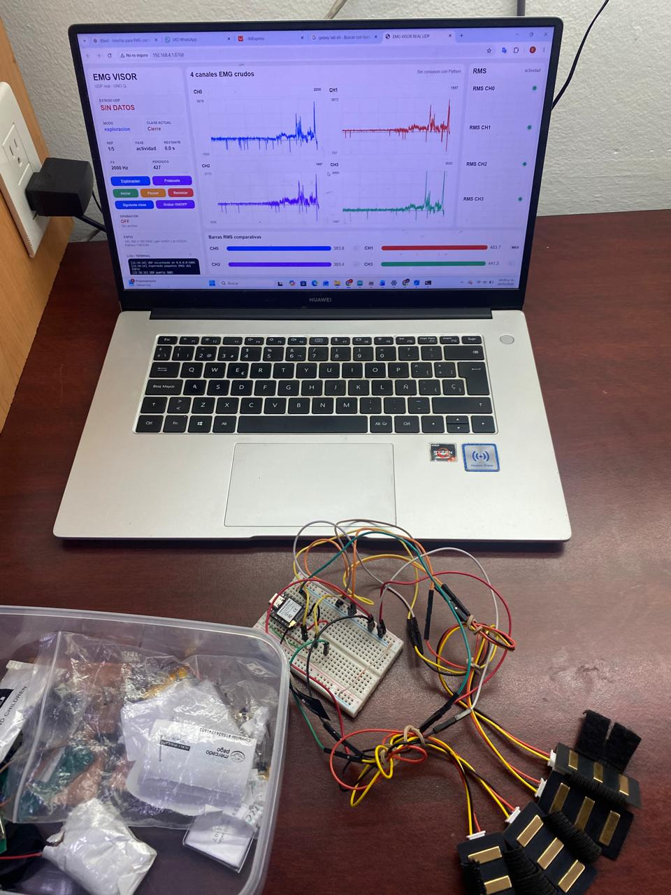
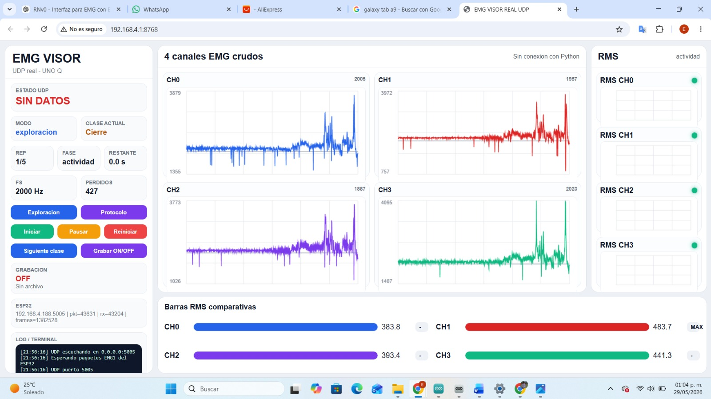
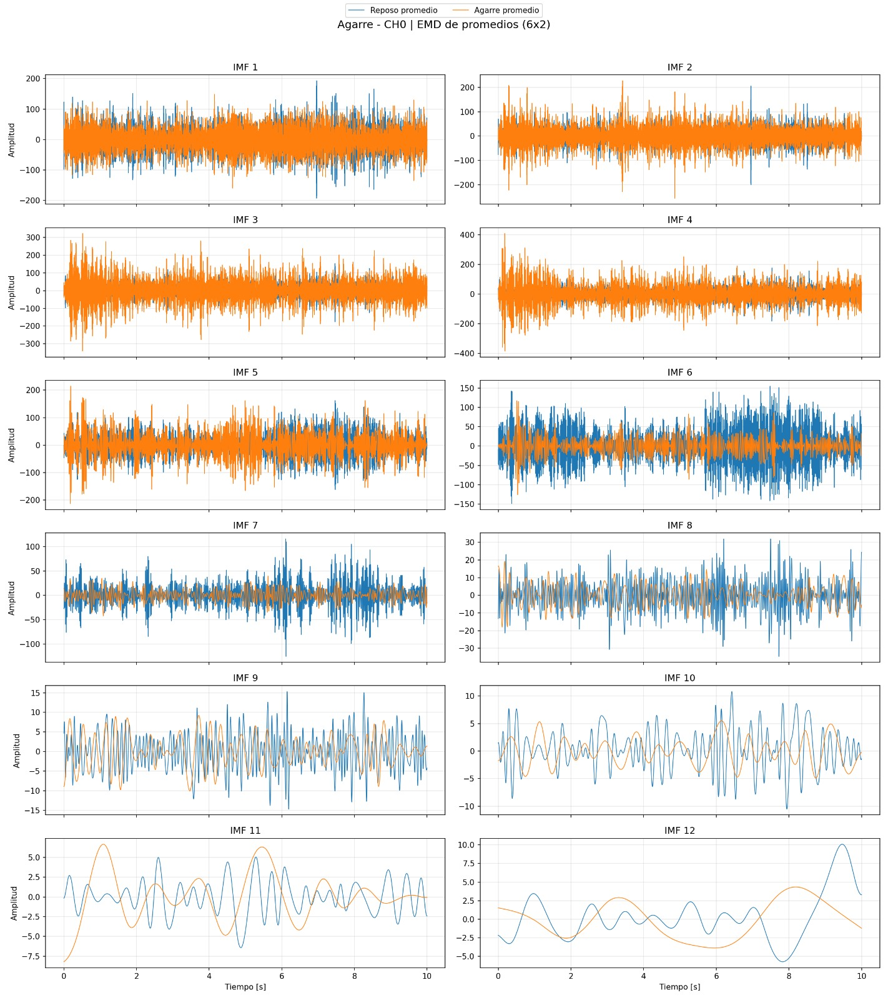
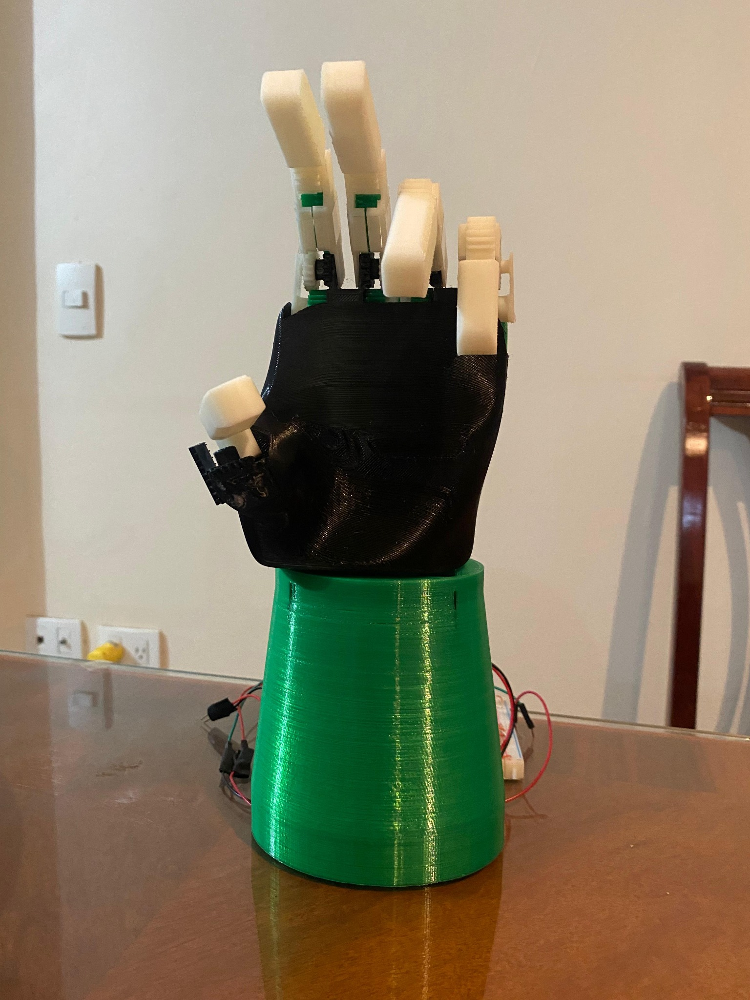

# EMG Project Context

## Background

This circuit is part of my work on acquiring, processing, and classifying surface electromyography (EMG) signals, with an interest in controlling a prosthetic hand prototype.

The acquisition and classification system is already functional. It records muscle signals, displays them through a web interface, and uses them to recognize movements. This work led to a simpler integrated-circuit implementation: detecting muscle activity using the mean absolute value (MAV) and adjustable thresholds.

The electronic designs, hand mechanism, 3D models, and web interface presented as my work on this page are my own designs and developments. The project also uses commercial components and existing development platforms, including the sensor linked below.

*Figure 1. EMG acquisition setup and its visualization interface.*

## Signal acquisition and analysis

The interface displays four EMG channels and allows their amplitude changes to be compared. This helps explore differences between rest and activity and prepare recordings for further analysis.

*Figure 2. The web interface with four signal channels and amplitude indicators.*

As part of this work, I have also explored processing methods such as empirical mode decomposition (EMD) to study different components of the signals.

*Figure 3. Example comparison of rest and grip using components obtained with EMD. This analysis is performed outside the MAV chip.*

## Connection to the integrated circuit

The chip in this repository provides a simple option for applications that need to detect activity without running a complete movement classifier.

It receives digital samples from one channel, subtracts an offset, calculates the absolute value, and averages blocks of 64 samples. It then compares the MAV with two thresholds to produce an activity output.

This output can be used by an external controller. The MAV can also be read as a signal feature for further processing. **The original system's gesture classification runs outside this chip.**

## Prosthetic hand prototype

Another part of my work is developing a hand prototype to explore the connection between muscle-signal acquisition and the movement of a physical mechanism.

*Figure 4. Hand prototype developed as part of the project.*

The following videos present related work:

- [Hand 3D model](https://youtu.be/YQ30B7H1PGA).
- [Prosthetic hand prototype in operation](https://youtu.be/Es1mF6aPttk).

These materials show the wider project context. Integrating the MAV chip with the prototype is planned for a later stage.

## Future integration and sharing

In parallel, I am working on an integrated operational transconductance amplifier (OTA) for EMG signals. The long-term goal is to connect the analog acquisition stage, analog-to-digital conversion, and MAV processing as parts of a more complete system.

I also plan to connect the results to the database we are developing through an external controller. This would allow activity records, MAV values, and configuration settings to be stored and compared across experiments. Integration of the OTA, MAV chip, and database remains future work.

**I plan to release the hand's 3D model and the EMG dataset in the future so that more people can study them, reproduce experiments, and build on this work.** These resources have not yet been released as part of this repository; their download links and terms of use will be added when they are available.

## Possible applications

- **Muscle activity detection:** distinguish periods of low and high signal amplitude.
- **Simple control interfaces:** provide an activity indication to an external controller.
- **Visual feedback:** display the activity state or MAV in an interface.
- **Experiment logging:** store results and settings to compare recording sessions.
- **Other sensors:** detect amplitude changes in conditioned sound or vibration signals.
- **Educational experiments:** study digital rectification, averaging, and hysteresis.

## Sensor for experiments

The proposed sensor is linked below as a reference for the acquisition setup:

[View the sensor on AliExpress](https://es.aliexpress.com/item/1005006343195832.html).

Check its supply requirements, output type, and ADC compatibility before connecting it. The analog signal connects to the acquisition system; the MAV chip receives only digital samples.
